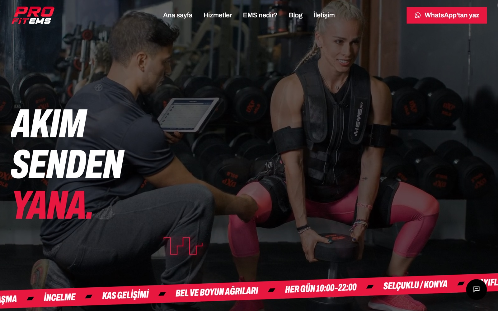
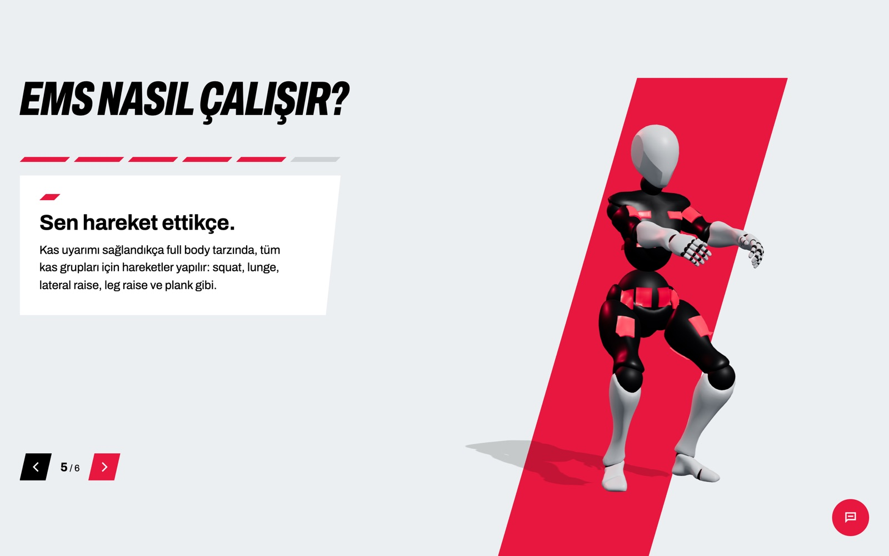
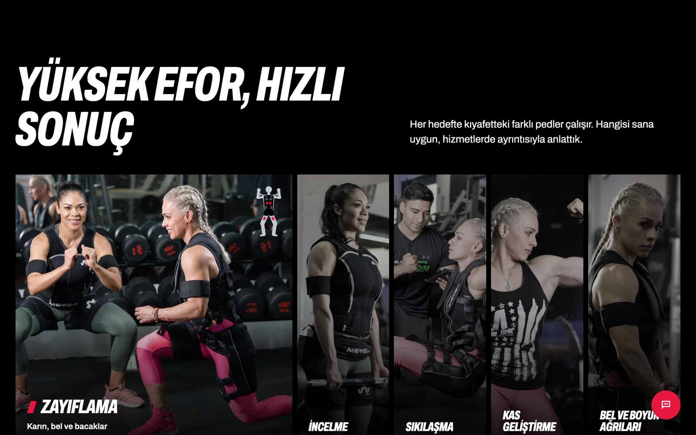
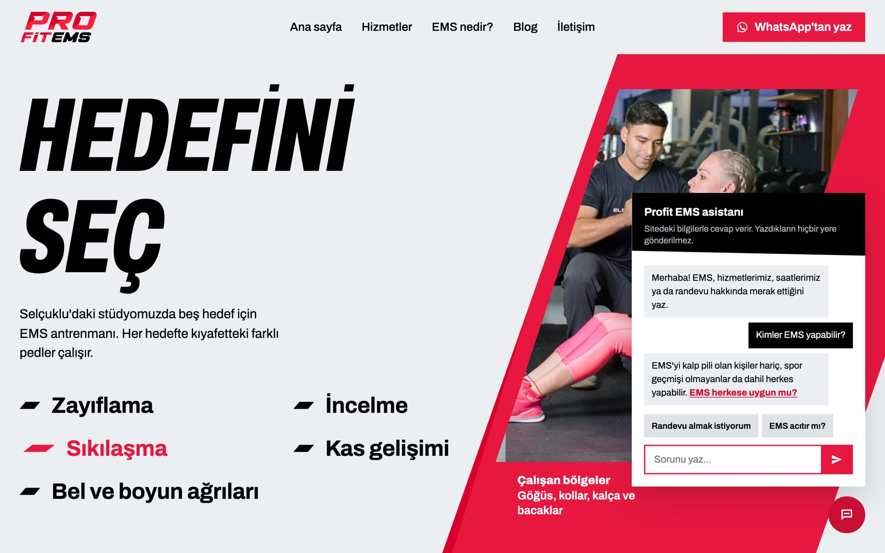
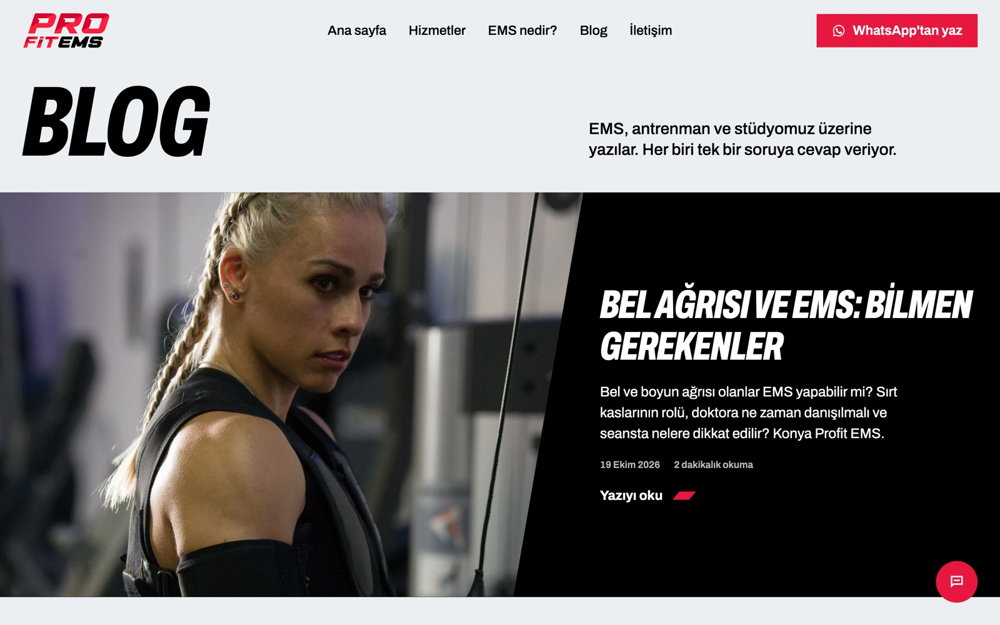
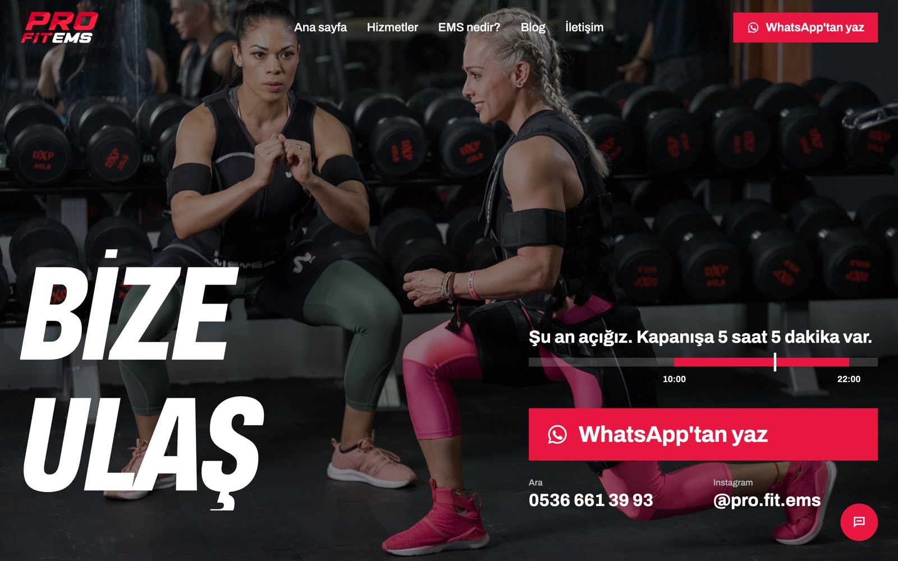
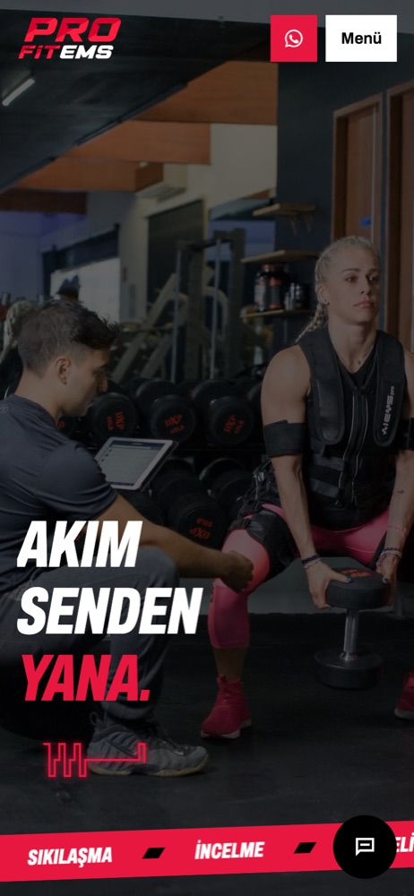
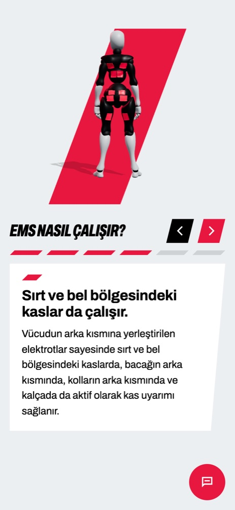
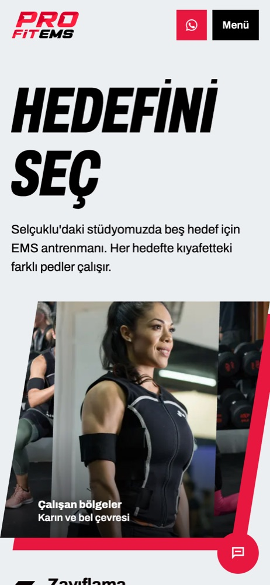

<div align="center">

# Profit EMS — Stüdyo Web Sitesi

[English](README.md) · **Türkçe**

**Konya'daki EMS (elektriksel kas uyarımı) stüdyosu Profit EMS için yapılmış, yayında olan web sitesi.**

[](https://astro.build/)
[](https://threejs.org/)
[](https://motion.dev/)
[](https://vercel.com/)
[](#lisans)

🔗 **[www.profitems.com](https://www.profitems.com)**

</div>



## Genel bakış

Gerçek bir müşteri projesi, şu an yayında: tek şubeli bir EMS stüdyosunun tanıtım sitesi. Amacı; çoğu kişinin tanımadığı bir antrenman yöntemini anlatmak, yerel aramalarda ("Konya EMS") görünmek ve ziyaretçiyi WhatsApp'tan yazışmaya yönlendirmek. Sitenin tamamı Türkçe.

Site statik (Astro), mobilde hızlı ve işletmenin kodla uğraşmadan SEO çalışmaya devam edebileceği şekilde kuruldu: sayfa başlıkları ve açıklamaları tek dosyada duruyor, yeni bir blog yazısı tek bir Markdown dosyası demek.

## Özellikler

### Ziyaretçi için
- **3D "EMS nasıl çalışır?"**: iskeletli bir Three.js mankenle altı adımlı anlatım. Manken kıyafeti giyiyor, kas gruplarının üzerinde elektrot pedleri beliriyor, arkadaki pedleri göstermek için dönüyor, sonra squat yapıp kaslarını sıkıyor. WebGL olmayan cihazlarda elle çizilmiş SVG figüre düşüyor.
- **Hedefini seç**: beş hedef (zayıflama, incelme, sıkılaşma, kas geliştirme, bel ve boyun ağrıları). Seçilen hedefte çalışan pedler vücut şemasında yanıyor.
- **Site asistanı**: EMS, beş hedef, saatler, konum ve randevu hakkındaki soruları cevaplayan sohbet penceresi. **Tamamen tarayıcıda çalışır**: hazırlanmış konu listesi (`src/data/asistan.ts`) üzerinde Türkçe karakterleri sadeleştiren anahtar kelime puanlaması. Sunucuya hiçbir şey gönderilmez; bilmediği soruyu WhatsApp'a yönlendirir.
- İletişim sayfasında **canlı açık/kapalı durumu** ("Şu an açığız. Kapanışa 5 saat 5 dakika var.") ve gün çizelgesi.
- Astro içerik koleksiyonlarıyla **blog**: taslak, güncelleme tarihi ve görsel kaynağı desteği.
- Her sayfada tek dokunuşla WhatsApp, arama ve Instagram; Google Haritası yalnızca tıklanınca yüklenir.

### Mühendislik
- **SEO**: sayfa başlık/açıklamaları tek dosyadan (`src/data/seo.ts`), canonical adresler, `lastmod` tarihini yazının ön bilgisinden alan otomatik sitemap ve `HealthClub`, `Service`, `FAQPage`, `BlogPosting`, `BreadcrumbList`, `WebSite` için JSON-LD.
- **Güvenlik**: parmak izine (hash) dayalı sıkı bir Content Security Policy. Astro paketlediği kodların parmak izini kendisi alıyor; sayfaya gömülü kalan kodlarınkini ise her derlemeden sonra küçük bir özel eklenti (`csp-satir-ici.mjs`) ekliyor. Böylece kodlar için `unsafe-inline` gerekmiyor. HSTS, çerçeve, referrer ve izin başlıkları `vercel.json` içinde.
- **Performans**: 3D motoru ayrı bir parça; yalnızca anlatım bölümüne yaklaşınca yükleniyor. Manken Meshopt ile sıkıştırılmış bir GLB (~800 KB). Görseller duyarlı WebP `srcset` ile geliyor, CSS sayfaya gömülü, parmak izli dosyalar uzun süre önbellekte tutuluyor.
- **Gizlilik (KVKK)**: yazı tipi sitenin kendi sunucusunda (Google Fonts yok), analiz ya da takip çerezi yok, asistan veri göndermiyor, harita istenince yükleniyor. KVKK aydınlatma metni ve çerez politikası sayfaları var.
- **Hareket**: tek bir orkestre giriş animasyonu ve yaylı geçişler (Motion), her kontrolde basma geri bildirimi, `prefers-reduced-motion` desteği.
- **İçerik anahtarları**: gerçek fotoğraf bekleyen bölümler (ekip, stüdyo) hazır ve bir anahtarla kapalı; tek veri dosyası düzenlenince yayına çıkıyor.

## Ekran görüntüleri

| 3D "EMS nasıl çalışır?" | Beş hedef |
|---|---|
|  |  |
| **Hizmetler + asistan** | **Blog** |
|  |  |



<p align="center">
  
  &nbsp;
  
  &nbsp;
  
</p>

## Kullanılan teknolojiler

| Katman | Teknoloji |
|---|---|
| Çatı | Astro 7 (statik çıktı, içerik koleksiyonları) |
| 3D | Three.js, GLTFLoader + Meshopt çözücü |
| Animasyon | Motion (yaylı geçişler), CSS |
| İçerik | Zod şemalı Markdown blog |
| Yayın | Vercel (`main`'e her push otomatik yayına çıkar), özel alan adı |

## Bilgisayarda çalıştırma

```bash
git clone https://github.com/OmerP14/profitems.git
cd profitems/site
npm install
npm run dev       # http://localhost:4321
npm run build     # statik çıktı: site/dist
```

Node 22.12 veya üstü gerekir. Ortam değişkeni gerekmez. İsteğe bağlı `SITE_URL` (`site/.env` içinde) test yayınları için canonical adresi değiştirir.

## Proje yapısı

```
site/
├── src/
│   ├── pages/          # Ana sayfa, hizmetler, EMS nedir, blog, iletişim, KVKK, çerez, 404
│   ├── content/blog/   # Blog yazıları (bir .md dosyası = bir yazı)
│   ├── data/           # Tek kaynaklar: işletme bilgisi, SEO, hizmetler, SSS, asistan konuları
│   ├── components/     # Menü, sayfa altı, asistan, vücut şeması
│   ├── scripts/ems3d.js# 3D manken: kıyafet, pedler, tek ilerleme değeriyle sürülen pozlar
│   ├── layouts/        # Ortak <head>, JSON-LD, sayfa altı
│   └── styles/
├── public/             # Görseller, giriş videosu, yazı tipleri, 3D model, favicon'lar
├── csp-satir-ici.mjs   # Derleme adımı: gömülü kodların parmak izini her sayfanın CSP'sine ekler
├── astro.config.mjs    # Site adresi, sitemap, CSP kuralları
└── vercel.json         # Güvenlik ve önbellek başlıkları
```

## Kaynaklar

- Geçici stok fotoğraflar: [Instituto Alpha Fitness, Pexels](https://www.pexels.com/@mralpha/) (Pexels lisansı). Stüdyonun kendi fotoğraflarıyla değiştirilecek.
- 3D karakter: [three.js örneklerindeki](https://github.com/mrdoob/three.js/tree/dev/examples/models/gltf) "Xbot" (aslen Mixamo), kırpılıp sıkıştırıldı. Kıyafet ve pedler kodla ekleniyor.
- Arşiv görselleri: Vesalius kas figürü (Wellcome Collection, CC BY 4.0), Duchenne de Boulogne 1862 (Cleveland Museum of Art, CC0), Mevlana Müzesi fotoğrafı (Alexostrov, CC BY-SA 3.0). Her biri kullanıldığı sayfada kaynak olarak gösteriliyor.

## Lisans

Bu repo **portfolyo ve eğitim amacıyla** paylaşılmıştır. Profit EMS adı, logosu, marka dosyaları, sertifikası ve işletme içerikleri Profit EMS'e aittir; izinsiz kullanılamaz. Üçüncü taraf görseller yukarıda yazan kendi lisanslarına tabidir.
